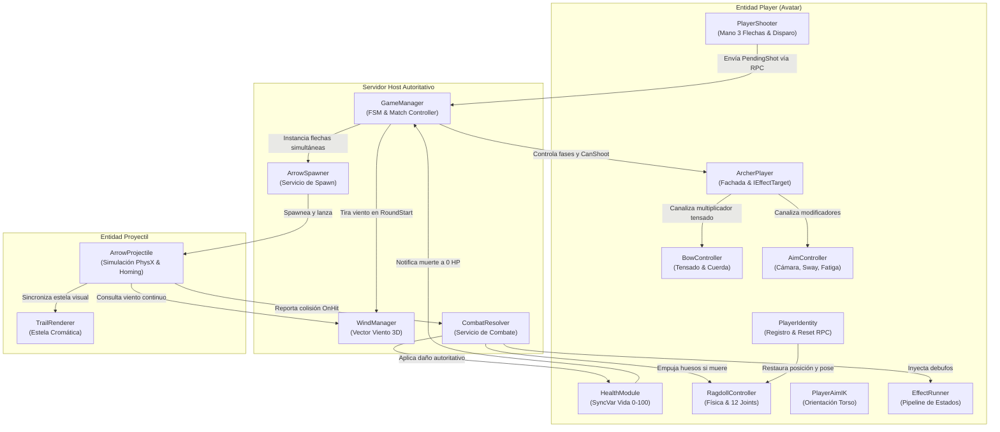

# 🏛️ EXPLICACIÓN TÉCNICA EXHAUSTIVA: GAME MANAGER Y EL CORE DE GAMEPLAY
## *JuegoSinNombre — Arquitectura de Combate, Ciclo de Red y Dominio de Juego*

---

## 1. Introducción y Filosofía Arquitectónica del Gameplay

El subsistema de **Gameplay** de *JuegoSinNombre* fue diseñado bajo tres principios innegociables de ingeniería de software para videojuegos multijugador:
1. **Autoridad Absoluta del Servidor (Server-Authoritative Loop)**: Los clientes son terminales de renderizado predictivo y captura de entrada. Ningún cliente puede alterar su vida, infligir daño, decidir si una flecha impactó o cambiar la fase de la partida.
2. **Separación de Responsabilidades y Servicios de Dominio Puros**: La lógica de negocio pesada no vive en componentes monolíticos ni en los avatares de los jugadores. Se delega a **servicios estáticos sin estado** (`CombatResolver`, `ArrowSpawner`) y a una **máquina de estados centralizada** (`GameManager`).
3. **Diseño Orientado a Datos (Flyweight ScriptableObjects)**: Las mecánicas y parámetros de flechas y efectos no están cableados en subclases de código C#. Se definen como assets inmutables en disco (`ArrowDefinition`, `EffectDefinition`) que el motor de físicas y el sistema de combate consumen en tiempo de ejecución.

---

## 2. Diagrama de Relaciones e Interacción de Componentes

El siguiente mapa conceptual ilustra la topología completa de dependencias y canales de comunicación en tiempo de ejecución:



---

## 3. GameManager.cs: El Motor de la Partida

[`GameManager.cs`](file:///D:/Unity2026/Assets/JuegoSinNombre/Scripts/Gameplay/GameManager.cs) es el cerebro orquestador del juego. Hereda de `NetworkIdentity` de PurrNet y opera exclusivamente como autoridad en el servidor para la toma de decisiones, mientras sincroniza el estado público a todos los observadores mediante `SyncVar`.

### 3.1 Estado de Red Replicado (`SyncVar`)
El estado de la partida se compone de 4 variables reactivas binarias y ligeras:
- **`currentPhase` (`SyncVar<int>`)**: Representa la fase activa del enum `RoundPhase`. Su mutación en el servidor dispara en los clientes los eventos `OnPhaseChanged` y `OnPhaseChangedGlobal`.
- **`roundNumber` (`SyncVar<int>`)**: Contador de ronda maestra actual (inicia en 1).
- **`player1Wins` (`SyncVar<int>`)**: Rondas ganadas por el jugador 1.
- **`player2Wins` (`SyncVar<int>`)**: Rondas ganadas por el jugador 2.
- **`MatchWinner` (`PlayerID?`)**: Propietario del triunfo de la partida completa (o `null` en caso de empate absoluto).

### 3.2 FSM: Ciclo de Micro-Rondas Simultáneas

La partida se divide en dos niveles de granularidad:
1. **Partida Maestra (Macro-Ronda)**: Estructurada en formato **Best of 3** (gana el primero en alcanzar 2 victorias) o **Best of 5** (gana el primero en llegar a 3). Calculado por la fórmula:
   $$\text{WinsNeeded} = \left\lfloor \frac{\text{MatchFormat}}{2} \right\rfloor + 1$$
2. **Micro-Ronda de Intercambio**: Sub-ciclo continuo donde ambos jugadores seleccionan flecha, tensan y disparan. Si ambos sobreviven a los impactos, la micro-ronda se reinicia inmediatamente conservando la vida restante.

```mermaid
sequenceDiagram
    autonumber
    participant P1 as Jugador 1 (Cliente)
    participant GM as GameManager (Servidor)
    participant P2 as Jugador 2 (Cliente)
    participant AS as ArrowSpawner (Servidor)

    Note over GM: Espera 2 jugadores conectados
    GM->>GM: StartNewMatchServer() (Ronda 1)
    
    rect rgb(30, 40, 60)
        Note over GM,P2: FASE: RoundStart & ConsumableWindow
        GM->>GM: WindManager.RollWind()
        GM->>P1: currentPhase = Aiming (SetCanShoot = true)
        GM->>P2: currentPhase = Aiming (SetCanShoot = true)
    end

    rect rgb(50, 40, 30)
        Note over P1,P2: FASE: Aiming (Disparo Simultáneo)
        P1->>GM: RegisterPendingShotServer(tiro P1)
        Note over P1: Arco bloqueado localmente
        P2->>GM: RegisterPendingShotServer(tiro P2)
        Note over P2: Arco bloqueado localmente
    end

    rect rgb(40, 60, 40)
        Note over GM,AS: FASE: Resolving (Vuelo Simultáneo)
        GM->>GM: currentPhase = Resolving
        GM->>AS: SpawnAndLaunch(tiro P1)
        GM->>AS: SpawnAndLaunch(tiro P2)
        Note over GM: Activa Watchdog de seguridad (12s)
    end

    rect rgb(60, 30, 30)
        Note over GM,P2: FASE: Outcome (Resolución Anatómica)
        CombatResolver->>GM: HandleHitResolvedServer()
        GM->>GM: currentPhase = Outcome
        alt ¿Alguien murió?
            GM->>GM: AwardRoundVictoryServer() -> Siguiente Ronda o GameOver
        else Ambos siguen vivos
            GM->>GM: CheckAndDealDepletedHandsServer()
            GM->>GM: ServerMicroRoundCycle() (Nueva flecha)
        end
    end
```



### 3.3 Mecanismos Clave del GameManager

#### A. Registro de Disparo y Lanzamiento Simultáneo (`RegisterPendingShotServer`)
Cuando un arquero dispara, no se crea la flecha en ese instante. El cliente despacha su `PendingShot` (que encapsula posición de origen, rotación, potencia de tensado, índice de slot consumido y definición de la flecha).
- El servidor guarda el tiro en el diccionario `_pendingShots[shooter]`.
- Apaga inmediatamente la capacidad de disparar de ese jugador (`archer.SetCanShoot(false)`).
- Cuando `_pendingShots.Count == 2`, se ejecuta `ExecuteSimultaneousShotsServer()`:
  - Cambia `currentPhase` a `Resolving`.
  - Descuenta el slot de munición en `PlayerShooter.ConsumeSlotServer()`.
  - Invoca `ArrowSpawner.SpawnAndLaunch()` para ambas flechas al mismo tiempo.
  - Inicia la corrutina **Watchdog**.

#### B. El Watchdog de Vuelo (`ServerResolvingWatchdogRoutine`)
Si ambos arqueros erran el disparo y las flechas caen en una zona sin colliders o vuelan hacia el horizonte infinito, el juego no se congela. El Watchdog espera `_impactResolutionWait + 3.0s`. Si la fase sigue en `Resolving` y no se reportó colisión, fuerza la transición a `Outcome`, permitiendo que el combate continúe.

#### C. Resolución Determinista de Fin de Partida y Prevención de Desyncs
Para evitar condiciones de carrera donde el cliente perdedor interpretaba un empate erróneo:
1. El servidor evalúa al ganador y lo asigna a la propiedad `MatchWinner`.
2. Emite el RPC con buffer: `NotifyMatchOverObserversRpc(matchWinner)` con `runLocally: true`.
3. **Solo después** conmuta `currentPhase.value = RoundPhase.GameOver`. Esto asegura que cuando la UI reaccione al cambio de fase, el ganador legítimo ya esté deserializado en la memoria del cliente.

---

## 4. Los Componentes del Jugador (Player Domain)

El avatar del jugador es una entidad modular compuesta por scripts especializados comunicados mediante inversión de dependencias:

### 4.1 ArcherPlayer.cs: La Fachada del Avatar
Implementa la interfaz [`IEffectTarget`](file:///D:/Unity2026/Assets/JuegoSinNombre/Scripts/Core/GameContracts.cs#L27). Centraliza el estado que los sistemas externos necesitan manipular sin acoplarse a los componentes internos:
- **`SensitivityMultiplier`**: Modifica la velocidad del mouse en `AimController` (afectado por frío/Skadi).
- **`AxesInverted`**: Invierte los ejes X e Y de puntería (afectado por Loki).
- **`DrawTimeMultiplier`**: Multiplica el tiempo requerido para tensar el arco (afectado por Skadi).
- **`BlurAmount`**: Ajusta el volumen de desenfoque visual en cámara.
- **`CanShoot`**: Flag maestro que bloquea o desbloquea la entrada del arco.
- **`IncomingDamageMultiplier`**: Multiplicador de vulnerabilidad (afectado por veneno de Jörmungandr).
- **Instancia del `EffectRunner`**: Aloja y corre el ciclo de efectos temporales en el servidor.

### 4.2 BowController.cs: Mecánica y Físicas del Arco
Controla el comportamiento gestual y kinestésico del arma:
- **Validación de Apuntado**: Exige mantener presionado el botón derecho del ratón (Aiming) antes de permitir el tensado con el botón izquierdo. Si se suelta el clic derecho, el tensado se cancela suavemente sin disparar.
- **Curva de Tensado no Lineal**: La tensión progresa a lo largo de `drawTime` (1.2s base) evaluando una `AnimationCurve`. Si la tensión acumulada no supera `minShootTension` (0.15), el tiro no se gatilla.
- **Sincronización de Flecha en Mano**: Utiliza una `SyncVar<bool> _isArrowVisible` con autoridad de propietario (`ownerAuth: true`) para activar o apagar el modelo visual `HumanArcher_ArrowInHand` en el rig 3D para todos los clientes en red.

### 4.3 AimController.cs: Cinemática de Cámara, Sway y Fatiga
Gobierna la visión y el pulso humano del arquero:
- **Modos de Cámara**:
  - *Modo Libre (Third-Person)*: Distancia de visión amplia para reconocimiento del entorno.
  - *Modo Apuntado (Over-the-Shoulder / First-Person)*: Interpola suavemente a offset `(0, 0, 0.05)` con reducción de campo visual (FOV).
- **Sway Procedural de Pulso (Ecuaciones Senoidales Asimétricas)**:
  Para simular la respiración y el temblor de las manos, genera micro-desplazamientos angulares continuos en Yaw y Pitch:
  $$\Delta \text{Pitch} = \sin(t \cdot f) \cdot A$$
  $$\Delta \text{Yaw} = \cos(t \cdot f \cdot 1.37) \cdot A$$
  *(donde $f = 1.1\text{ Hz}$ y $A = 1.5^\circ$)*.
- **Mecánica de Fatiga Muscular**: Si el jugador sostiene la cuerda tensada por más de `fatigueRampTime` (2.5 segundos), la amplitud $A$ se multiplica gradualmente hasta por `fatigueMaxMultiplier` (2.0x), forzando al jugador a disparar o reposar la cuerda.

### 4.4 PlayerShooter.cs: Arsenal Dinámico y Mano Táctica
Administra la baraja de 3 flechas disponibles para el arquero:
- **Array de Mano Activa**: `_currentHand = new ArrowDefinition[3]`.
- **Selección de Munición**: Mapeada a teclas numéricas `1, 2, 3` o rueda del ratón (`Mouse ScrollWheel`).
- **Despacho del Tiro**: Al soltar la cuerda en tensión válida, empaqueta el struct `PendingShot` y llama al RPC del servidor `RegisterShotServerRpc()`.
- **Reparto Procedural de Flechas**: Cuando las 3 flechas han sido consumidas (`AllSlotsConsumed`), el servidor ejecuta `CheckAndDealNewHandOnServer()` seleccionando 3 flechas aleatorias del `arsenalPool` e invoca el evento `OnHandDealt` para accionar la ruleta gráfica estilo *Slot Machine*.

### 4.5 PlayerIdentity.cs: Identidad y Reinicio de Ronda
- Mantiene el diccionario estático global `allPlayers` mapeado por `PlayerID` de PurrNet.
- Expone `TryGetLocal(out PlayerIdentity local)` para acceso instantáneo al jugador dueño sin coste de CPU.
- Aloja el RPC esencial `ResetPlayerRoundStateObserversRpc(pos, rot)`:
  - Posiciona al arquero en su punto de spawn original.
  - Restaura la rotación hacia el adversario.
  - Ordena a `RagdollController` restablecer los huesos cinemáticos y reactivar el `Animator`.

### 4.6 RagdollController.cs: Gestión Cinemática de PhysX
Maneja la alternancia entre animación procedural por esqueleto (`Animator`) y simulación física por gravedad y articulaciones (12 `Rigidbody` y `CharacterJoint`):
- **Prevención de Warnings en Unity 6**: Unity 6 arroja excepciones si se asigna velocidad lineal o angular a un cuerpo cinemático. Para garantizar estabilidad:
  ```csharp
  // Cancela velocidades residuales ANTES de congelar cinemáticamente
  if (!rb.isKinematic)
  {
      rb.linearVelocity = Vector3.zero;
      rb.angularVelocity = Vector3.zero;
  }
  rb.isKinematic = true;
  ```
- **Transición Letal (`EnableRagdoll`)**: Desconecta el Animator, desactiva el collider principal del cuerpo, habilita la gravedad en todos los huesos y transfiere el impulso cinético del impacto mediante `ApplyImpactForce()`.

---

## 5. Balística, Viento y Resolución de Impactos

### 5.1 ArrowProjectile.cs y el Viento Dinámico
La flecha es una entidad gobernada por las leyes de Newton en el servidor:
- **Aceleración por Viento**: En cada paso de `FixedUpdate`, se suma la aceleración del viento provista por `WindManager`:
  $$\vec{v}_{\text{next}} = \vec{v} + \left( \vec{g} + \vec{w} \cdot \mu_{\text{wind}} \right) \cdot \Delta t$$
- **Alineación a la Velocidad**: Si `alignToVelocity == true`, la rotación de la flecha sigue tangencialmente la curva parabólica:
  $$\text{Rotation} = \text{Quaternion.LookRotation}(\vec{v}_{\text{linear}})$$
- **Autoguiado Homing (Flecha Apolo)**: Si `homing == true`, calcula el vector hacia el transform del torso rival y rota progresivamente el vector de velocidad con `Vector3.RotateTowards(..., homingTurnSpeed * dt)`.
- **Estela Visual Dinámica (TrailRenderer)**:
  - Al crearse, se configura mediante el RPC `ConfigureTrailObserversRpc` con colores, anchos y tiempo de vida configurados en el `ArrowDefinition`.
  - Al colisionar (`OnHit`), apaga inmediatamente la emisión (`trail.emitting = false`) para evitar que la estela se estire como una banda elástica si el objetivo cae en ragdoll.

### 5.2 CombatResolver.cs: El Árbitro Autoritativo de Combate
Es un servicio estático puro. Cuando una flecha impacta contra un `DamageHitbox`, se ejecuta la secuencia matemática:
1. **Multiplicador Anatómico**:
   - Cabeza (`Head`): $\times 2.0$ (Impacto crítico).
   - Torso (`Torso`): $\times 1.0$ (Impacto estándar).
   - Extremidades (`Arm` / `Leg`): $\times 0.75$ (Daño mitigado).
2. **Multiplicador de Vulnerabilidad**: Si la víctima tiene activo un efecto como el veneno de Jörmungandr, se aplica el `IncomingDamageMultiplier` (ej. $\times 1.35$).
3. **Cálculo de Daño Final**:
   $$\text{Daño} = \text{DañoBase} \cdot \text{MultAnatómico} \cdot \text{MultVulnerabilidad}$$
4. **Aplicación de Daño y Robo de Vida**:
   - Invoca `HealthModule.ApplyDamage(daño)`.
   - Si la flecha tiene `lifestealRatio > 0` (Flecha Vampírica de Lamia al 35%), restaura vida al tirador:
     $$\text{Curación} = \text{DañoEfectivo} \cdot 0.35$$
5. **Inyección de Estados**: Despacha los `EffectDefinition[]` al `ArcherPlayer` del enemigo.
6. **Impulso de Ragdoll**: Si el impacto reduce la vida a cero, transmite la energía cinética de la masa y velocidad de la flecha directamente al hueso impactado.

---

## 6. Pipeline de Rendimiento y Telemetría

[`PerformanceTelemetryMonitor.cs`](file:///D:/Unity2026/Assets/JuegoSinNombre/Scripts/Gameplay/PerformanceTelemetryMonitor.cs) opera en segundo plano para auditoría continua:
- **Patrón Zero-Allocation**: Toda la concatenación de texto para el HUD y los logs en consola utiliza buffers estáticos `StringBuilder` reutilizados, evitando generar basura en el Garbage Collector (GC).
- **Métricas Reales Validadas**:
  - Tasa de refresco en Host: **270.3 FPS** (3.7 ms de frametime).
  - Tasa de refresco en Cliente: **245.0 FPS** (4.1 ms de frametime).
  - Consumo de Heap Mono: **39 a 71 MB**.
  - Recolecciones de basura: Estables y sin picos durante el intercambio de proyectiles.

---

## 7. Resumen de Responsabilidades para Defensa Técnica

| Script | Rol Primario | Dependencia Principal | Patrón de Diseño |
| :--- | :--- | :--- | :--- |
| **`GameManager`** | Máquina de estados y orquestación de partida Bo3/Bo5 | `PlayerIdentity`, `CombatResolver` | Finite State Machine (FSM) + Singleton |
| **`ArcherPlayer`** | Hub del avatar e interfaz de efectos de estado | `IEffectTarget`, `EffectRunner` | Facade (Fachada) |
| **`BowController`** | Mecánica de tensado, cuerda y validación de input | `ArcherPlayer`, `AnimationCurve` | State Machine interna |
| **`AimController`** | Cinemática de cámara, temblor procedural y fatiga | `InputSystem`, `Camera` | Procedural Motion Controller |
| **`PlayerShooter`** | Gestión de mano de 3 flechas y solicitud de disparo | `ArrowDefinition`, `GameManager` | Inventory / Flyweight Consumer |
| **`ArrowProjectile`** | Balística física, viento dinámico y estelas visuales | `Rigidbody`, `WindManager` | Autonomous Physical Agent |
| **`ArrowSpawner`** | Instanciación de proyectiles y descarte de auto-colisión | `ArrowProjectile`, `PurrNet` | Stateless Domain Service |
| **`CombatResolver`** | Cálculo anatómico de daño, robo de vida y ragdoll | `HealthModule`, `DamageHitbox` | Stateless Domain Service |
| **`RagdollController`** | Alternancia segura entre animación y simulación de huesos | `CharacterJoint`, `Rigidbody` | Strategy / Bridge Pattern |
| **`WindManager`** | Generación y replicación del vector 3D de viento | `IWindProvider` | Provider / Service |
